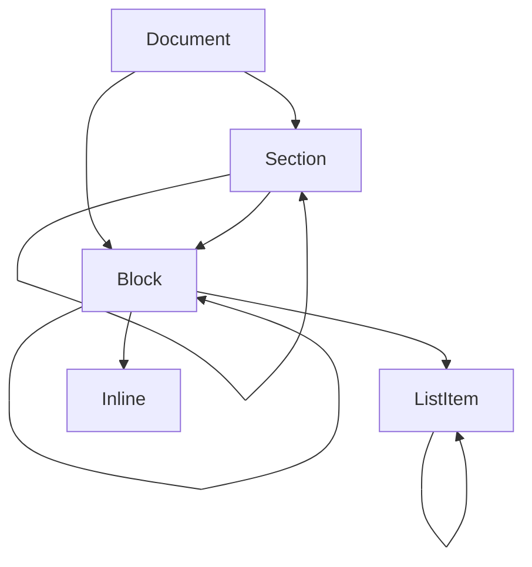

# Data Model: AsciiDoc Parse Phase

**Feature**: [spec.md](./spec.md) | **Plan**: [plan.md](./plan.md) | **Contracts**: [contracts/README.md](./contracts/README.md)

The parse phase reads text and produces one tree. This document describes the entities in that tree
and the state the phase carries while building it. The PHP interfaces are the source of truth; this
document describes their shape, their invariants, and the rules that constrain them. It does not
restate method signatures except where an invariant depends on one.

## The tree

A document is a block. A section is a block. A block may contain sections, blocks, list items and
inlines. A list item is a block and may contain blocks. An inline is not a block and cannot contain
anything.

### Document

The root node and the only node that is returned to the caller. Extends `BlockInterface`, so it has
children, attributes and content like any block, and adds the document title and the diagnostics
collected while reading it.

Invariants:

- Exactly one document exists per parse, and it is the root.
- Its `getSourcePath()` is the source's path when the source is a file, and null when it is text.
- Its attributes are the header attribute entries after all resolution, including the intrinsic
  attributes the parser sets before the header is read.
- Its diagnostics are the same collection the parser wrote to, not a copy. A caller that reads them
  after the parse sees everything the parse reported.

### Section

A titled node whose level is its depth in the tree. Extends `BlockInterface`.

Invariants:

- `getLevel()` is 0 for a part title, 1 for a level-1 section, and so on. It is derived from the
  title's marker count, not from the section's position in the tree.
- `getId()` is never null and never empty. A section with no authored id has one generated, and the
  generation happens in the prepare stage, not when the section is created, because the generated id
  is derived from the section's substituted title and the title is not substituted until the prepare
  stage.
- `isSpecial()` is true when the section carries a special section style, which changes how it is
  rendered rather than what it contains.

### Block

Any node with content, with children, or with both. Extends `NodeInterface`.

Invariants:

- `getContext()` is the block's type name and is never empty.
- `getBlocks()` returns a list, never null, and is empty for a block with no children.
- `getContent()` returns the block's own prepared content and is the empty string for a compound
  block. Children are reached through `getBlocks()`. See D6 in [research.md](./research.md).
- A block whose content model is compound has an empty `getContent()`. A block whose content model is
  simple, verbatim or raw has children only if the parse produced them, which for those models it
  does not.
- The source path and source line identify where the block began in the input, after include
  resolution. They are null only for a block with no input location, which the first pass does not
  produce.

### ListItem

An item of a list. Extends `BlockInterface`, so it can hold blocks, and adds the item's own text.

Invariants:

- `hasText()` is true exactly when `getText()` is non-empty.
- For an unordered or ordered list item, `getText()` is the item's text and `getTerms()` is empty.
- For a description list item, `getTerms()` is a non-empty list and `getDescription()` is either the
  item's description block or null when the item has a term and no description.
- `getDescription()` returns a list item, not a block, because a description can itself contain
  blocks.

### Inline

A node that exists only inside content and never as a child of a block. Extends `NodeInterface` and
adds text, type and target.

Invariants:

- An inline is produced by the substitutor when a converter asks for
  markup it must build itself, such as an image or an anchor. It is never produced by the block
  parser.
- `getType()` names the inline construct and `getTarget()` is the construct's target, both empty for
  an inline that has neither.
- An inline never has children and never has blocks.

## Value types

### Source

A path or a text body, with the text body taking precedence when both are supplied. It does not read;
reading is the reader's job, because an included file's contents are not known to the caller. See
`docs/planning/contracts/parse-phase.md` for the citation.

### ParseOptions

The per-parse configuration: safe mode, initial attributes, base directory, maximum include depth and
the source map flag. Immutable, and consumed by `ParserInterface::parse()`.

Invariants:

- The base directory is absolute, or the parse fails before reading anything.
- The maximum include depth is a positive integer.
- Initial attributes are applied before the header is read, so a header entry overrides them and a
  document attribute reference sees them.

### ContentModel

A closed set of five cases: simple, verbatim, raw, compound, empty. It decides which substitution
group applies to a block's content. Every block has exactly one.

| Model | Applies | Substitution group |
|---|---|---|
| Simple | paragraph, list item, table cell, admonition, quote, example, sidebar, open | normal |
| Verbatim | listing, literal, source, pass with a subs attribute | verbatim |
| Raw | pass with no subs attribute, stem | none |
| Compound | section, example, sidebar, open with blocks, document | none at the block, children substituted |
| Empty | block with no content and no children | none |

### Diagnostic and SourceLocation

A diagnostic is a reason code, a severity, a message and an optional location. A location is a source
path plus a line, a column or both.

Invariants:

- A diagnostic whose reason code names a location always has one. The collector rejects a diagnostic
  that breaks this.
- The reason codes are the parse phase's reporting vocabulary and are closed. A condition the phase
  wants to report that has no code is a defect in the vocabulary, not a reason to invent a code at
  the call site.

### Reader state

The reader's state is not a node and is not returned. It is the state the read and preprocess stages
carry:

| Part | Meaning |
|---|---|
| Current line | The line the cursor is on, after preprocessing |
| Marks | Positions on the current line already consumed |
| Include stack | One frame per open include, each with a path, a line, and the resolved target |
| Pending lines | Lines read ahead by a multi-line construct and not yet consumed |
| Conditional stack | One frame per open `ifdef`, `ifndef` or `ifeval`, each recording whether the enclosing frame is taken |

Invariants:

- The include stack depth never exceeds the configured maximum, and the depth check happens when the
  include is opened, not when it is discovered.
- A conditional frame that is not taken still consumes its lines and still recognises its
  terminators, because an untaken branch must not unbalance the stack.
- A mark is never set beyond the current line's end, and reading past the end of the current line
  reports the exhaustion rather than returning an empty string.

### SubstitutionContext

The state a substitution pass needs, carried as one value rather than as arguments: the block being
substituted, the document, the attribute store, the converter, the source location for diagnostics
and a flag for whether the pass is the normal group or the verbatim group.

Invariants:

- The attribute store is the document's store, not a copy. A substitution that sets an attribute
  changes the document.
- The converter is the one supplied to `parse()`, and a substitution that needs to build markup asks
  it.

## Validation rules

The following rules are checked where they are stated, and a violation is a defect rather than a
recoverable condition:

1. A base directory that is not absolute is rejected before any file is read.
2. A maximum include depth that is not positive is rejected before any file is read.
3. An include whose target resolves outside the base directory is reported as an escape and is not
   read. See D8 in [research.md](./research.md).
4. An include that would exceed the depth limit is reported and is not read.
5. A missing include is reported once, with the location of the include directive.
6. A section whose level skips a level is reported and is attached to the nearest open section at a
   lower level.
7. An attribute reference that does not resolve is left as written, not blanked, unless the reference
   is dropped by an unset attribute.
8. A diagnostic with a reason code that requires a location and no location is rejected by the
   collector.

## What the model deliberately does not hold

- No source map on the nodes. The source map flag is carried in the options and its output shape is
  deferred, because the tree already carries a path and a line per node and the richer map is only
  needed by an editor integration, which is not in this feature.
- No back-reference from a node to its parent. A converter that needs the parent is walking the tree
  and can carry the parent itself.
- No converter on a node. See D5 and D6.
- No inline tree in the first pass. The substitutor returns a string, which is what the converter
  needs. A caller that wants an inline tree is a second feature.
