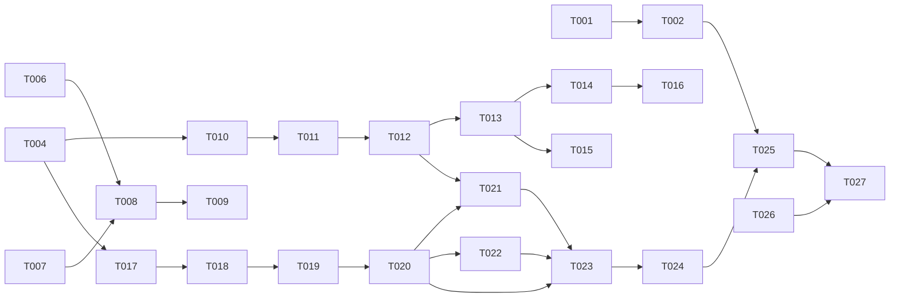

# Tasks: AsciiDoc Parse Phase

**Feature**: [spec.md](./spec.md) | **Plan**: [plan.md](./plan.md) | **Research**: [research.md](./research.md)

Input: the design documents in this directory. Contracts: `src/`. This task list implements the
contracts; it does not change them. A task that needs a contract to change stops and records why.

## Path conventions

- `src/` production code, one directory per collaborator, matching the contract layout.
- `test/unit/` namespace `PhpiidocTest\`.
- `test/integration/` namespace `PhpiidocTestIntegration\`.
- `test/fixtures/` the parity corpus, one directory per fixture, `input.adoc` plus `expected.html`.
- Every test class carries `#[CoversClass]` and `#[CoversMethod]` for what it exercises.
- Gates run only as `docker compose exec tooling ...`.

## Phase 1: Setup

### T001 Harvest the parity corpus

Copy the reference implementation's fixtures that cover the constructs in scope into
`test/fixtures/`, one directory per fixture, and generate `expected.html` from Ruby Asciidoctor for
each. Record the reference version and the command used in `test/fixtures/README.md`. Do not write new
inputs; a corpus written by the implementer tests the implementer's reading of the specification.

**Acceptance**: `test/fixtures/README.md` names the reference version, and every fixture directory
holds an `input.adoc` and a non-empty `expected.html`.
**FRs**: none directly; blocks every parity test.

### T002 Build the parity harness

`test/integration/ParityTest.php`. A data provider walks `test/fixtures/`, parses `input.adoc`, renders
with the HTML5 converter, and compares against `expected.html` by DOM structure and text content. A
failure reports the first differing node path, not the first differing byte.

**Acceptance**: the harness fails on a deliberately corrupted fixture and passes on a trivially
correct one.
**Depends on**: T001.

### T003 Wire the test namespaces and coverage metadata

Confirm `phpunit.xml.dist` suites match `test/unit` and `test/integration`, and that a new test class
without coverage metadata fails the run. This is a check, not a change, unless something is missing.

**Acceptance**: `vendor/bin/phpunit` reports the existing 45 tests green.

## Phase 2: Foundational

### T004 Implement the mutable attribute store

`src/Attribute/MutableAttributes.php` against `MutableAttributesInterface`. Intrinsic attributes are
set before the header is read. A reference to an unset attribute is left as written. Setting an
attribute records its source so the document can restore state at the end of the parse.

**Acceptance**: unit tests for set, get, delete, unset, intrinsic precedence and restore.
**FRs**: FR-013, FR-033, FR-040.

### T005 Implement the diagnostic collector

`src/Diagnostic/DiagnosticCollector.php` against `DiagnosticCollectorInterface`. Rejects a diagnostic
whose reason code requires a location when no location is supplied.

**Acceptance**: unit tests for collection, severity filtering and the location invariant.
**FRs**: FR-041.

### T006 Implement the line cursor

`src/Reader/Reader.php` and `src/Reader/ReaderFactory.php` against the reader contracts. Covers
peeking, marking and restoring, reading until a terminator or a blank line, line ending normalisation
and byte order mark stripping.

**Acceptance**: unit tests per `ReadLinesBehaviour` case, plus normalisation and mark restore.
**FRs**: FR-001, FR-002, FR-003, FR-004.

### T007 Implement the include resolver

`src/Reader/IncludeResolver.php` against `IncludeResolverInterface`. Resolves a target to a path,
substitutes attribute references in the target before resolving, and answers containment by comparing
real paths segment by segment, walking to the nearest existing ancestor when the target does not
exist. An escape is reported as an escape, never as a missing file.

**Acceptance**: unit tests for a plain target, a target with an attribute reference, a target with
`..` inside the base directory, a target outside it, and a symlink inside the base directory pointing
outside it.
**FRs**: FR-005, FR-009, FR-010.
**Note**: D8 in [research.md](./research.md).

## Phase 3: Preprocessing (S1, S2)

### T008 Implement include processing

Replace `include::[]` at the line that names it, push and pop the include stack, enforce the depth
limit at the point the include is opened, and terminate a self-referential include instead of
recursing. Honour safe mode through `SafeMode::processesIncludes()`.

**Acceptance**: integration tests for a single include, a nested include, an include at the depth
limit, an include past it, a missing include, a self-referential include, and an include at each safe
mode level.
**FRs**: FR-005, FR-007, FR-008, FR-011.
**Depends on**: T006, T007.

### T009 Implement conditional processing

`ifdef`, `ifndef`, `ifeval`, `endif` and the single-line forms, evaluated against the attribute store
as it stands at that line. An untaken branch still consumes its lines and still balances the stack.

**Acceptance**: integration tests for each directive, for nesting, for an untaken branch containing a
terminator, and for a conditional whose attribute is set later in the document.
**FRs**: FR-006.
**Depends on**: T008.

### T010 Implement attribute entries and the header boundary

Attribute entries in the header are recorded in the store; attribute entries after the first blank
line are body content. A header entry overrides an initial attribute.

**Acceptance**: integration tests for the three entry forms, for a header entry overriding an initial
attribute, and for an entry after the first blank line staying in the body.
**FRs**: FR-012, FR-013, FR-014.
**Depends on**: T004.

## Phase 4: Structure (S3, S4, S5)

### T011 Implement the header

Parse the document title, the author line, the revision line and the header attribute entries before
the body.

**Acceptance**: integration tests for a title-only header, a full header, and no header.
**FRs**: FR-012.
**Depends on**: T010.

### T012 Implement sections

A section node per section title, recording level, authored id and special style. Nest by level and
close sections whose level is reached or passed. Honour the section level limit.

**Acceptance**: integration tests for a flat document, nesting three deep, a level skip, a section at
the level limit and one past it, and a section with an authored id.
**FRs**: FR-015, FR-016, FR-017, FR-018.
**Depends on**: T011.

### T013 Implement delimited and simple blocks

Paragraph, literal, listing, source, quote, sidebar, example, open, pass, comment and stem. Apply a
delimited block's attribute list and honour its substitution attribute. Record block metadata. Report
an unterminated block and still produce the block. A comment block is absent from the tree.

**Acceptance**: integration tests per block type, for an attribute list on a delimited block, for an
unterminated block, and for a comment block leaving no node.
**FRs**: FR-019, FR-020, FR-021, FR-022, FR-023, FR-024.
**Depends on**: T012.

## Phase 5: Lists and tables (S6)

### T014 Implement list parsing

Unordered, ordered, description and callout lists, one item node per item, with item continuation,
nested lists and attached blocks.

**Acceptance**: integration tests per list type, for nesting, for continuation, for an attached block,
and for a description item with a term and no description.
**FRs**: FR-025, FR-026, FR-027.
**Depends on**: T013.

### T015 Implement table recognition

Recognise a table block and record its attributes. Rows and cells are not parsed in this phase.

**Acceptance**: an integration test asserting the table node exists with its attributes and no cell
children.
**FRs**: FR-028.
**Depends on**: T013.

### T016 Implement callout accounting

Number callouts in a verbatim block, record the callout list against it, and report a callout list
whose numbers do not correspond to callouts in the block.

**Acceptance**: integration tests for a matching pair, a mismatch in each direction, and a callout
list with no preceding verbatim block.
**FRs**: FR-029, FR-037.
**Depends on**: T014.

## Phase 6: Substitution (S7)

### T017 Implement special characters and quotes

`src/Substitutor/` against the substitution contracts. One method per substitution family. Special
characters and quotes are separate substitutions applied in the group's order.

**Acceptance**: unit tests per substitution, plus an ordering test that fails if the two are swapped.
**FRs**: FR-031, FR-032.
**Depends on**: T004.

### T018 Implement attribute reference resolution in content

Resolve references against the live store, including intrinsic attributes and entries set earlier in
the document.

**Acceptance**: unit tests for a plain reference, a reference with a default, a reference to an unset
attribute, and a reference set by an entry above it.
**FRs**: FR-033.
**Depends on**: T017.

### T019 Implement inline macros

Images, links, cross references, footnotes and the passthrough family, delegating markup construction
to the converter.

**Acceptance**: unit tests per macro, plus a test asserting the converter receives the inline and
returns the markup, and that no macro text survives into the result.
**FRs**: FR-034, FR-042.
**Depends on**: T018.

### T020 Implement the substitution groups

The normal, verbatim, header and reference-text groups as ordered applications of the substitutions,
driven by the block's `ContentModel`.

**Acceptance**: unit tests per group asserting the ordered application, and a test that a raw block is
untouched.
**FRs**: FR-031, FR-038, FR-039.
**Depends on**: T019.

### T021 Implement forward cross reference resolution

Resolve a cross reference to a target defined later in the document, by a second walk over section
titles after the tree is complete.

**Acceptance**: integration tests for a backward reference, a forward reference, and a reference to a
target that does not exist.
**FRs**: FR-036.
**Depends on**: T020, T012.

### T022 Implement section id generation

Generate a section id from the converted title when the document supplies none, in the prepare stage
rather than at section creation.

**Acceptance**: integration tests for a generated id, an authored id winning, and two sections whose
titles generate the same id.
**FRs**: FR-035.
**Depends on**: T020.

## Phase 7: Assembly (S8)

### T023 Implement the document node and the parse entry point

`src/Parser/Parser.php` against `ParserInterface`. Composes the stages in order, returns the document
with its attributes restored to their initial state, and exposes the diagnostics collected.

**Acceptance**: integration tests for a document with a title and no body, a body and no title, and an
empty source; plus an assertion that the attribute store is back to its initial state afterwards.
**FRs**: FR-001, FR-040, FR-041, FR-044.
**Depends on**: T020, T021, T022.

### T024 Record source locations on every node

Every node carries a source path and a source line, naming the file the node began in after include
resolution.

**Acceptance**: an integration test asserting a non-null path and line on every node of a document
that spans an include.
**FRs**: FR-043.
**Depends on**: T023.

## Phase 8: Parity and polish

### T025 Close the parity gaps

Run the parity harness and close the differences fixture by fixture. Each closed gap gets a comment
naming the reference behaviour it restores.

**Acceptance**: `ParityTest` green across the whole corpus.
**Depends on**: T002, T023, T024.

### T026 Record what is deliberately not implemented

Add `docs/planning/contracts/parse-phase-omissions.md` listing each behaviour the first pass omits and
the consequence of omitting it, matching the omission table in the approved plan.

**Acceptance**: the record exists and every omission in the approved plan appears in it.

### T027 Run the gates

```powershell
docker compose exec tooling vendor/bin/phpunit
docker compose exec tooling mago lint --ignore-baseline
docker compose exec tooling mago analyze
docker compose exec tooling mago format --check
docker compose exec tooling vendor/bin/infection --threads=4
```

**Acceptance**: zero findings, with no baseline entry added for new code. Coverage at 100 percent line
and branch per source file.

## Dependencies



T003, T005 and T006 have no prerequisite. T004 blocks the whole parser. T002 blocks parity but not
implementation, so the parity harness and the parser can proceed in parallel.

## Parallel opportunities

- T003, T005, T006 can run alongside T001.
- T007 and T004 are independent.
- After T020, T021 and T022 are independent of each other.
- T015 and T016 are independent of each other.
